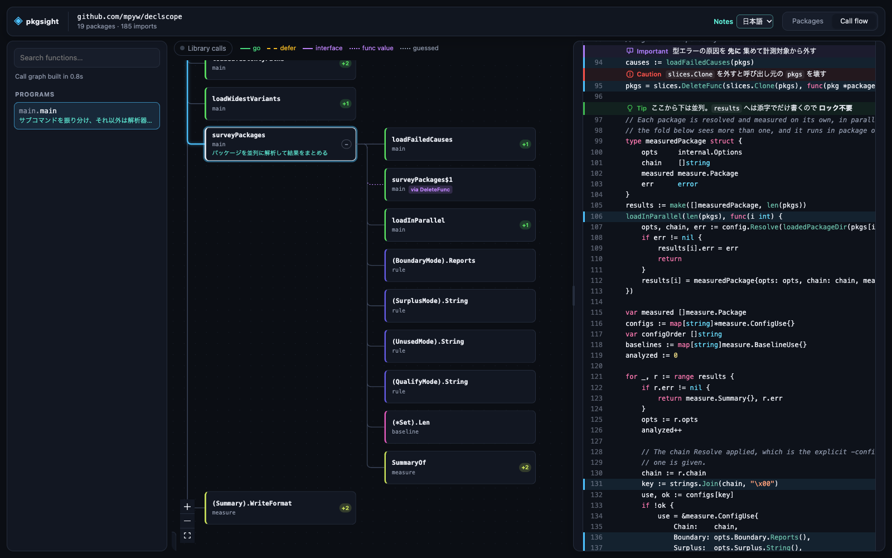
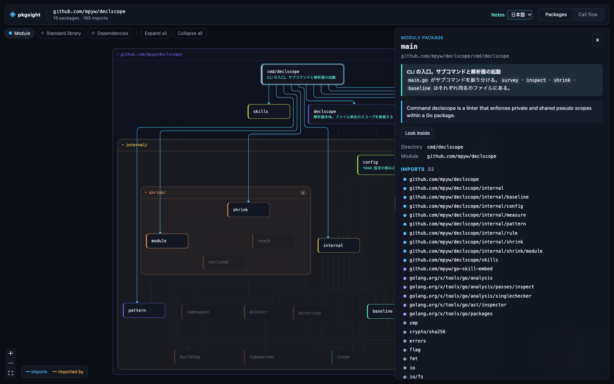
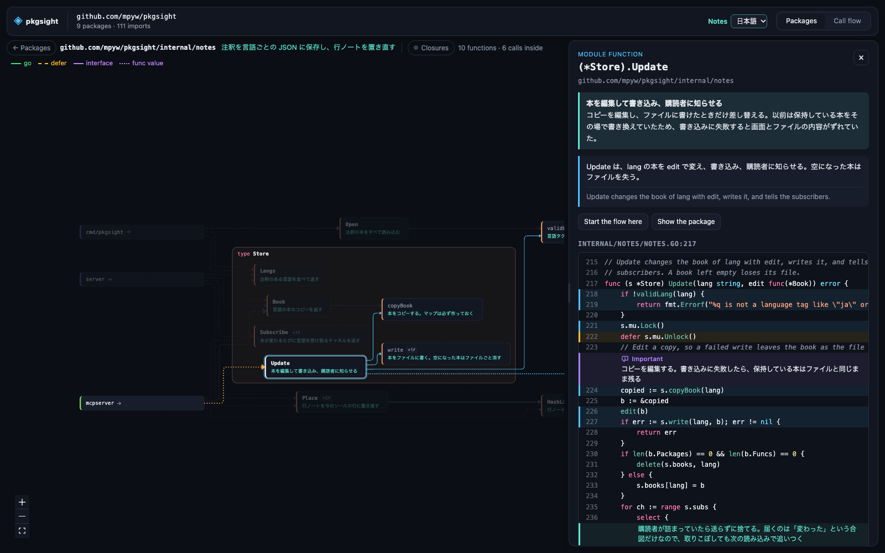

<div align="center">


# pkgsight

See how a Go module is built and how its code runs, in your browser.

[](https://github.com/mpyw/pkgsight/actions/workflows/ci.yml)
[](https://codecov.io/gh/mpyw/pkgsight)
[](https://pkg.go.dev/github.com/mpyw/pkgsight)

</div>

> [!WARNING]
> This is an early draft. The flags, the notes format and the MCP tools may change.

pkgsight draws a Go module as a map of its packages, and follows the calls from any function. Claude can add notes in your language, and they show next to the code.



## Install

```bash
mise use "github:mpyw/pkgsight@0.2.0"
```

<details>
<summary>Other ways</summary>

Pin it in a project's `mise.toml`:

```toml
[tools]
"github:mpyw/pkgsight" = "0.2.0"
```

From a release archive:

```bash
VERSION=0.2.0
curl -LO "https://github.com/mpyw/pkgsight/releases/download/v${VERSION}/pkgsight_${VERSION}_darwin_arm64.tar.gz"
curl -LO "https://github.com/mpyw/pkgsight/releases/download/v${VERSION}/checksums.txt"
shasum -a 256 -c checksums.txt --ignore-missing
tar xzf "pkgsight_${VERSION}_darwin_arm64.tar.gz"
```

From source:

```bash
git clone https://github.com/mpyw/pkgsight
cd pkgsight
mise install
mise run build
```

> [!WARNING]
> `go install` builds a binary without the web UI, which is built separately and embedded by the steps above.

</details>

## Usage

| Command | |
| --- | --- |
| `pkgsight serve [packages]` | Open the module in the browser, and serve MCP for notes |
| `pkgsight export [packages]` | Write the module, with its notes and its source, into one HTML file |
| `pkgsight notes check [packages]` | List the notes whose code changed or is gone. Fails if there are any |
| `pkgsight --version` | Print the version |
| `pkgsight --help` | List the commands. `pkgsight <command> --help` lists a command's flags |

Package patterns work as for the go command, and default to `./...`.

### pkgsight serve

In a Go module:

```bash
pkgsight serve
```

The browser opens on the package map. The call flow is ready a few seconds later, once the call graph is built.

| Flag | Default | |
| --- | --- | --- |
| `--dir`, `-C` | `.` | Directory to run in |
| `--addr` | `localhost:7878` | Address to listen on |
| `--open` | `true` | Open the browser |
| `--watch` | `true` | Analyze again when the code changes |

When you save a file, the browser shows the new code in a few seconds, and keeps what is on screen. The URL holds what is on screen, so you can share a view by its link.

### Package map



Double-click a package to see the functions inside it and the calls between them. A large package starts with one box per file. Click a file to open it. Click a function to see only it and the functions it calls or is called by.



### Call flow

Start from the sidebar. It lists the `main` functions, and the functions a library calls, such as a command's action or `ServeHTTP`. You can also search for any function. Click a function to open its calls, and use the badge on its right edge to close them again.

Some calls cannot be seen. Calls made inside dependencies and calls through reflection are missing. An interface call on a value from a dependency is a guess, drawn dotted.

### pkgsight export

Writes everything `pkgsight serve` shows into one HTML file, which opens in a browser without pkgsight:

```bash
pkgsight export -o pkgsight.html
```

| Flag | Default | |
| --- | --- | --- |
| `--dir`, `-C` | `.` | Directory to run in |
| `--output`, `-o` | `pkgsight.html` | File to write |

The file shows the notes as they are, and cannot write new ones.

> [!CAUTION]
> The file holds the source code of the module. Share it only with people who may read the code.

### pkgsight notes check

Lists the [notes](#notes) that no longer match the code:

```console
$ pkgsight notes check
ja: orphan function example.com/sample/app.Gone
ja: stale function example.com/sample/app.Run
pkgsight: 2 notes do not match the code; ask an assistant to run the refresh_notes prompt
```

| Flag | Default | |
| --- | --- | --- |
| `--dir`, `-C` | `.` | Directory to run in |
| `--lang` | All languages | Check only this language. Repeat it for more |

| State | Meaning |
| --- | --- |
| `stale` | The code changed since the note was written |
| `orphan` | The package or function is gone, or renamed |

It always checks against the whole module. Package patterns only choose which notes to list.

| Exit status | When |
| --- | --- |
| 0 | Every note matches the code |
| 1 | Some note does not, or the module could not be loaded |
| 2 | The command line is wrong |

## Notes

`pkgsight serve` also serves [MCP](https://modelcontextprotocol.io/). Connect Claude Code to it:

```bash
claude mcp add --transport http pkgsight http://localhost:7878/mcp
```

Then ask, for example: *"Explain the flow from main in Japanese."* The notes appear in the browser as Claude writes them. There are also prompts for common requests:

```text
/mcp__pkgsight__explain_flow main ja
/mcp__pkgsight__explain_package internal/config ja
/mcp__pkgsight__explain_module ja
```

Notes are saved in `.pkgsight/notes/<lang>.yaml`, one file per language. Commit them, and everyone who runs pkgsight on the repository sees them.

A note remembers the code it was written for. When that code changes, the note is marked as written for an older version. Ask Claude to bring the notes up to date:

```text
/mcp__pkgsight__refresh_notes ja
```

To fail CI while any note is out of date, run [`pkgsight notes check`](#pkgsight-notes-check).

## Contributing

`mise run check` runs the tests and linters. See [AGENTS.md](AGENTS.md) for the code layout and the design notes.
